# 🌌 PORTAL CENTRAL — NÚCLEO SAWARDO

> [!INFO] **ESTADO OPERATIVO VIGENTE**
> - **Fecha Canónica:** **31 de Floris, Año 3 (Día continuo 806)**.
> - **Escena Activa:** 21:10 en los jardines de Gutiérrez Estate; terminó la cena posterior al cierre financiero y Max sigue bajo control exclusivo del usuario.
> - **Operación en curso:** Revisión de la garantía contra Ravenwood; responsabilidades de Corven y Verrick todavía no resueltas.
> - **Comunicaciones:** Dos terminales **G1** en enlace directo (`DOCTOR` y `BAKARINA`) entre Max, [[03_PERSONAJES/Aria|Aria]] y [[03_PERSONAJES/Yuki_Moriyama_Lady_Marianne|Yuki]]. Mizuki investiga por separado en el exterior.
> - **Alerta de Cumpleaños:** 🎂 Próxima: **Natalia, 14 de Solalto**. Después Aria (22) y Sayaka/Evelyn (30).
> - **Documento de Continuidad Principal:** [[05_CONTINUIDAD/CURRENT_STATE_31_FLORIS_AÑO3|CURRENT_STATE_31_FLORIS_AÑO3]]
> - **Frentes de apertura de Solalto:** auditoría de **G1.03**; materiales del Serath-Maru; *La cámara secreta* desde el 10; dos obras teatrales y misterios abiertos.
> - **Frentes de Max:** Casa Ardel entra en cierre ordenado; Ravenwood, Cecilia/Mizuki, G1/cámara histórica, Gremio/Kira y economía siguen disponibles según decisión del usuario.

---

## 🧭 MAPA NAVEGACIONAL DEL VAULT

```mermaid
flowchart TD
    Inicio["📍 00_INICIO_OBSIDIAN"] --> Canon["📜 01_CANON"]
    Inicio --> Mundo["🌍 02_MUNDO"]
    Inicio --> Personajes["👥 03_PERSONAJES"]
    Inicio --> Sistemas["⚙️ 04_SISTEMAS"]
    Inicio --> Continuidad["⏳ 05_CONTINUIDAD"]
    Inicio --> Agentes["🧠 06_AGENTES"]
    Inicio --> Roleplay["🎭 07_ROLEPLAY"]
    Inicio --> Finanzas["💰 FINANZAS"]
    Inicio --> Amistades["🇵🇪 AMISTADES_TIERRA"]
    Inicio --> Fuentes["📚 00_FUENTES"]
    
    classDef main fill:#10b981,stroke:#047857,stroke-width:2px,color:#fff;
    classDef node fill:#1e293b,stroke:#475569,stroke-width:1px,color:#e2e8f0;
    class Inicio main;
    class Canon,Mundo,Personajes,Sistemas,Continuidad,Agentes,Roleplay,Finanzas,Amistades,Fuentes node;
```

---

## 🏛️ LOS PILARES DEL MUNDO

### 1. 📜 Canon y Directrices Maestras
- [[01_CANON/DOCTRINA_DE_ENRIQUECIMIENTO_Y_VIDA_AUTONOMA|Doctrina de Enriquecimiento y Vida Autónoma]]: La ley suprema: cada acción deja huella; los NPCs avanzan por cuenta propia.
- [[01_CANON/REGLAS_INMUTABLES|Reglas Inmutables de la Realidad]]: La regla del sello de Serath, secretos de estado y límites del mundo.
- [[01_CANON/CONTRADICCIONES|Matriz de Resolución de Contradicciones]]: Auditoría de estratos y precedencia autoral.

### 2. 👥 Personajes y Sociedad
- **Protagonista:** [[03_PERSONAJES/Max38|Max Gutiérrez (39 años)]] — Ingeniero limeño, estratega, portador secreto de Sawardo y patriarca familiar.
- **Matrimonio:** [[03_PERSONAJES/Serath_Vale|Comandante Serath Vale]] — Esposa legítima desde el Día 260. Hija del Rey Aldric (secreto de Estado).
- **Hogar Gutiérrez:** [[03_PERSONAJES/Ryu_Gutierrez|Ryu Gutiérrez (18 a)]] *(Oficial naval)* y [[03_PERSONAJES/Kenji_Gutierrez|Kenji Gutiérrez (16 a)]] *(Chef de cocina)*.
- **Socia & Amiga:** [[03_PERSONAJES/Aria|Aria]] — Undine ancestral libre, investigadora y ancla afectiva.
- **Administración & Red:** [[03_PERSONAJES/Natalia_Thornwell|Natalia]], [[03_PERSONAJES/Elise_Goldcrest|Elise]], [[03_PERSONAJES/Vivienne_Silverstream|Vivienne]] y el aprendiz [[03_PERSONAJES/Leo_Mercer|Leo Mercer]].
- **Guardia & Aliados:** [[03_PERSONAJES/Kael_Ironheart|Kael]], [[03_PERSONAJES/Torin|Torin]], [[03_PERSONAJES/Lyssa|Lyssa]], [[03_PERSONAJES/Kira|Kira (Guildmaster)]].
- **Círculo Isekai:** [[03_PERSONAJES/Haruto_Kazagami|Haruto]] & [[03_PERSONAJES/Liora|Liora]], [[03_PERSONAJES/Ren|Ren]], [[03_PERSONAJES/Siri|Siri]], [[03_PERSONAJES/Kazuki|Kazuki]].
- **Compañía & Teatro:** [[03_PERSONAJES/Goran|Goran]], [[03_PERSONAJES/Biro|Biro]], [[03_PERSONAJES/Darian|Darian Holt]], [[03_PERSONAJES/Jasmine|Jasmine]], [[03_PERSONAJES/Misa|Misa]], [[03_PERSONAJES/Amane|Amane]].
- 👉 *Ver lista completa:* [[03_PERSONAJES/INDEX|Índice Maestro de Personajes]].

### 3. 🌱 Vida Autónoma y Relaciones (Año 3)
- [[05_CONTINUIDAD/ESTADO_RELACIONES_Y_ROMANCES_AÑO3|Matriz de Relaciones y Romances]]:
  - ❤️ **Max – Serath:** Matrimonio pleno y maduro.
  - ⚡ **Haruto – Liora:** Pareja formal consolidada.
  - 🌸 **Kael Ironheart – Natalia Thornwell:** Interés mutuo en desarrollo autónomo (escenas de comidas, paseos, bromas y celos de Kael hacia Leo Mercer). *(Amane y Kael son solo compañeros de equipo en Afrodita).*
  - 🇵🇪 **Take – Aysha:** Mejores amigos independientes de Lima; no son pareja.
- [[05_CONTINUIDAD/REGISTRO_DE_VIDA_AUTONOMA_Y_METAS_AÑO3|Tablero de Metas Vivas de NPCs]]: Qué hace cada personaje sin la presencia de Max.
- [[05_CONTINUIDAD/MISIONES_PROPUESTAS_POR_NPC_AÑO3|Misiones Propuestas por NPCs]]: Encargos e iniciativas nacidas del mundo.
- [[06_AGENTES/MOTOR_DE_AFINIDAD_Y_ROMANCE|Motor de Afinidad y Romance]]: Ciclo `SEMILLA → ACERCAMIENTO → RECIPROCIDAD → DECISIÓN → RELACIÓN_FORMAL`.

### 4. 💰 Economía y Finanzas Reales
> [!TIP] **ESTADO DE CUENTAS (CORTE 26 DE BRUMA, AÑO 3)**
> - **Oro Líquido en Caja Fuerte:** **905,905 monedas de oro**.
> - **Flujo Estructural Ordinario:** **7,270 oro / mes** (tras aumentos de sueldo a Natalia, Elise y Vivienne a 800 oro/mes c/u).
> - **Sedes del Dragón de Oro:** Tornhaven (fundacional) y Aldoria (capitalina). Pollo a la brasa con todas las cremas y chifa.
> - **Restaurante La Bruma Azul:** Restaurante tradicional pesquero en los muelles de Tornhaven (anterior a Zhong-Kyo; cuna del cebiche y chicharrón de pulpo).
> - 📖 *Auditoría oficial:* [[FINANZAS/FINANZAS_CANON_VIGENTE|Finanzas Canon Vigente]] e [[FINANZAS/HISTORIAL_FINANCIERO_CONSOLIDADO|Historial Consolidado]].

### 5. 🎭 Directrices de Narración y Roleplay
- [[07_ROLEPLAY/DIRECTRICES_MAESTRAS_ROLEPLAY|Directrices Maestras de Roleplay]]: Control exclusivo del jugador sobre Max, formato limpio `Nombre: diálogo`, acción física observable primero.
- [[07_ROLEPLAY/ESTILO_DE_NARRACION_Y_VOZ|Estilo de Narración y Voz]]: Prosa cinematográfica sensorial, picardía criolla limeña, complicidad matrimonial íntima y comida como puente social.
- [[07_ROLEPLAY/SISTEMA_DE_OPCIONES_Y_CONTINUAR|Sistema de Opciones]]: Las 5 opciones obligatorias al cerrar turno narrativo (Buena, Neutral, Caótica, Especial, Automática) y uso del `/continuar`.
- [[AMISTADES_DE_LA_TIERRA_DE_MAX/GUIA_DE_VOZ_Y_ROLEPLAY_TIERRA|Voz de las Amistades de la Tierra]]: Jerga limeña auténtica de WhatsApp para Take, Aysha, Docta y Grace.

---

## 🗺️ VISTA GRÁFICA INTERACTIVA

> [!NOTE] **CÓMO EXPLORAR VISUALMENTE**
> 1. Abre el archivo [[MAPA_VISUAL_NUCLEO_SAWARDO.canvas|MAPA_VISUAL_NUCLEO_SAWARDO.canvas]] para ver el tablero visual completo de facciones, personajes y arcos interconectados.
> 2. Presiona `Ctrl + G` en Obsidian para abrir la **Vista Gráfica Global (Graph View)**. Los nodos ya están coloreados por módulo:
>    - 🟡 **Dorado:** Canon y Reglas
>    - 🟢 **Esmeralda:** Personajes
>    - 🟣 **Púrpura:** Sistemas y Magia
>    - 🟠 **Ámbar:** Continuidad y Cronología
>    - 🔴 **Rosa/Rojo:** Motores y Agentes
>    - 🔵 **Azul:** Amigos de la Tierra
>    - 🍏 **Lima:** Finanzas y Negocios
>    - ⚪ **Gris:** Fuentes originales

---

## 🤖 PUERTA DE ENLACE CHATGPT / DRIVE
- [[Nucleo_Sawardo_ChatGPT_2026-10-08|Nucleo_Sawardo_ChatGPT_2026-10-08.md]]: Archivo maestro optimizado para el contexto de ChatGPT / Proyecto GPT.
- Paquete sincronizado localmente en: `C:\projects\PAQUETE_DRIVE_NUCLEO_SAWARDO` y `C:\projects\NUCLEO_SAWARDO_DRIVE.zip`.
